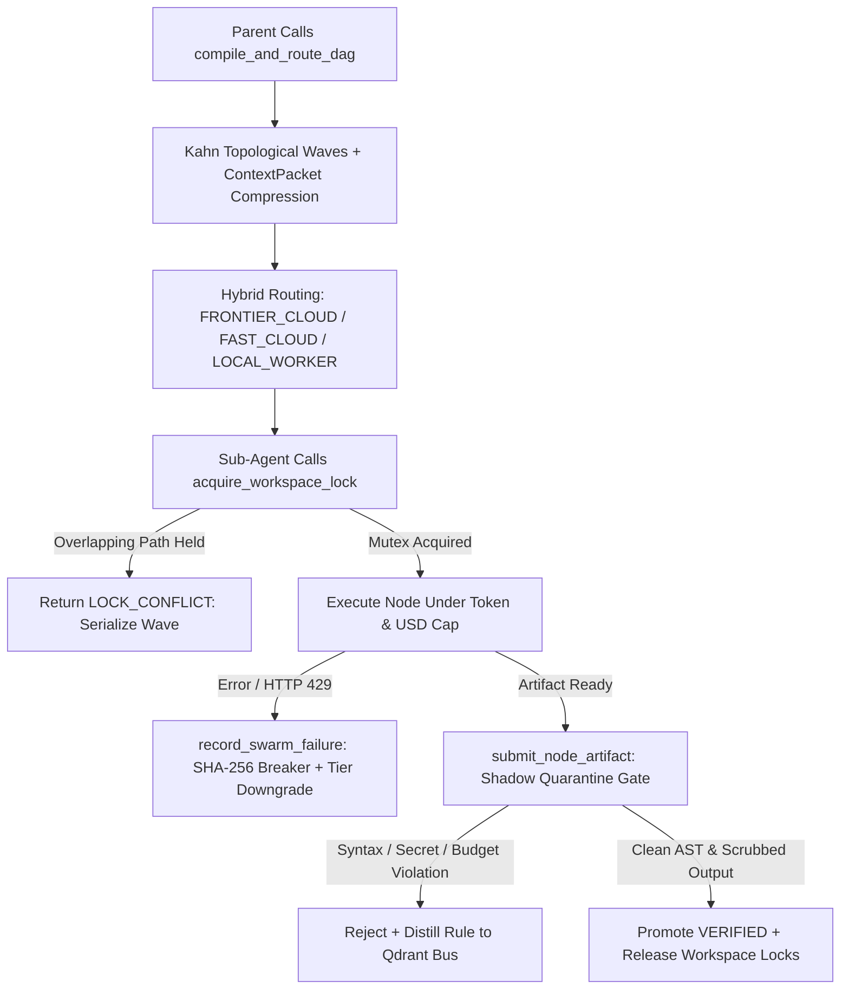

# Aegis-Swarm-Kernel

**Production-Grade Multi-Agent DAG Orchestrator, Hybrid Model Router, Financial Circuit Breaker, and Transactional Workspace Control Plane MCP Server** powered by **FastMCP**, **Pydantic v2**, **Python `ast`**, and **Qdrant**.

`aegis-swarm-kernel` replaces fragile, $O(N^2)$ token-bloated multi-agent chat loops with a deterministic L7 control plane. Before sub-agents write a line of code or burn Frontier LLM budget, the kernel compiles tasks into topological execution waves, compresses handoffs into `ContextPacket` payloads, locks shared files atomically, routes simple subtasks to local/fast tiers, and validates generated artifacts through a **Shadow Quarantine Gate** with a **300s SHA-256 anti-loop circuit breaker**.

---

## Core Architectural Modules (`src/aegis_swarm/`)

1. **`dag_router.py` (`DAGCompilerAndRouter`)**:
   - Validates workflow dependencies and computes parallelizable topological execution waves using **Kahn's algorithm**, deterministically rejecting cyclic dependencies (`DAG_CYCLE_ERROR`).
   - Routes every node across 3 model tiers (`FRONTIER_CLOUD`, `FAST_CLOUD`, `LOCAL_WORKER`) and strips raw chat history filler into compact `ContextPacket`s containing only file paths, signatures, constraints, and `<5ms` recalled procedural rules.
2. **`budget_guard.py` (`FinancialCircuitBreaker`)**:
   - Meters cumulative input, output, and thinking tokens alongside real-time USD spend per node and per DAG (`AEGIS_SWARM_DEFAULT_DAG_BUDGET_USD=0.50`, `AEGIS_SWARM_DEFAULT_NODE_TOKEN_CAP=4000`).
   - Immediately trips `BUDGET_EXCEEDED` on ceiling breaches, computes `RATE_LIMIT_FALLBACK` downgrades (`FRONTIER_CLOUD -> FAST_CLOUD -> LOCAL_WORKER`) on HTTP 429 errors, and trips `LOOP_DETECTED` via normalized SHA-256 fingerprints (`300.0s` TTL).
3. **`workspace_lock.py` (`TransactionalWorkspaceCoordinator` & `ShadowQuarantineGate`)**:
   - Enforces atomic mutex path locking (`acquire_workspace_lock`) across concurrent waves, returning `LOCK_CONFLICT` if parallel sub-agents attempt overlapping file mutations.
   - Validates submitted artifacts inside quarantine via `ast.parse` (Python) and `json.loads` (JSON) plus 8 deterministic regex secret/PII scrubbers before promoting `QUARANTINED -> VERIFIED` and releasing node locks.
4. **`swarm_bus.py` (`SharedEpisodicBus`)**:
   - Qdrant-backed cross-agent shared procedural memory (`aegis_swarm_shared_memory`) supporting `<5ms` rule recall, automatic `<= 200`-char rule distillation, and adaptive utility scoring (`+0.1` / `-0.4` with auto-pruning below `0.3`).
5. **`kernel_engine.py` & `server.py` (`FastMCP("Aegis-Swarm-Kernel")`)**:
   - Unifies all subsystems behind 6 MCP tools, resource `aegisswarm://telemetry`, prompt `l7_swarm_orchestrator_prompt`, and dual transport (`stdio` default and `--transport sse --port 8080`).

---

## Hybrid Tier Pricing Model

| Tier | Representative Models | Input / 1M Tokens | Output / 1M Tokens | Workload Routing Target |
| :--- | :--- | :---: | :---: | :--- |
| **`FRONTIER_CLOUD`** | Frontier reasoning models | $3.00 | $15.00 | Architecture, deep debugging, concurrency, security design |
| **`FAST_CLOUD`** | High-speed flash models | $0.15 | $0.60 | Summarization, docs, schema mapping, lightweight synthesis |
| **`LOCAL_WORKER`** | Local Qwen-Coder / local models | $0.00 | $0.00 | Boilerplate generation, pytest suites, syntax refactoring |

---

## Control Plane Flow



---

## L7 Swarm Benchmark (`evals/run_swarm_benchmark.py`)

Workload: **15 multi-agent software engineering workflows** (4 interdependent DAG nodes + parallel file edits + 8x sub-agent error storm).

| Metric | Unconstrained Chat Swarm (All-Frontier Baseline) | Aegis-Swarm-Kernel (DAG + Hybrid + Quarantine) | Improvement |
| :--- | :---: | :---: | :---: |
| **Context Tokens / Workflow** | 43,787 tokens | 3,964 tokens | **-90.9% token drain (`ContextPacket`)** |
| **API Cost / 100 Workflows (USD)** | $21.12 | $1.45 | **-93.1% cost (Hybrid Cloud+Local)** |
| **Parallel File Collision / Race Rate** | 100.0% | 0.0% | **-100% races (Mutex Lock Gate)** |
| **Cascading Error Storm Loop Rate** | 100.0% | 0.0% | **-100% loops (SHA-256 Breaker)** |
| **End-to-End Orchestration Overhead** | N/A (Uncontrolled) | 18.59 ms | **Deterministic wave + lock control plane** |

---

## Quickstart

### 1. Install Package & Dev Dependencies
```bash
python -m pip install -e ".[dev]"
```

### 2. Run Offline Test Suite
```bash
pytest -v --no-header
```

### 3. Run L7 Multi-Agent Benchmark
```bash
python evals/run_swarm_benchmark.py
```

### 4. Start the MCP Server

**Local IDE Mode (`stdio`, default):**
```bash
python -m aegis_swarm.server
```

**Networked Microservice Mode (`sse`):**
```bash
python -m aegis_swarm.server --transport sse --host 127.0.0.1 --port 8080
```

---

## Environment Configuration (`AEGIS_SWARM_*`)

| Variable | Default | Purpose |
| :--- | :--- | :--- |
| `AEGIS_SWARM_DEFAULT_DAG_BUDGET_USD` | `0.50` | Maximum USD spend permitted per compiled DAG |
| `AEGIS_SWARM_DEFAULT_NODE_TOKEN_CAP` | `4000` | Default per-node token cap (`input + output + thinking`) |
| `AEGIS_SWARM_COOLDOWN_SEC` | `300.0` | TTL window (seconds) for SHA-256 anti-loop breaker |
| `AEGIS_SWARM_LOCK_TTL_SEC` | `120.0` | Lease duration (seconds) for transactional file mutex locks |
| `AEGIS_SWARM_PRUNE_THRESHOLD` | `0.3` | Utility score threshold below which shared rules auto-prune |
| `AEGIS_SWARM_QDRANT_IN_MEMORY` | `true` | Embedded `:memory:` Qdrant mode with zero external dependencies |
| `AEGIS_SWARM_QDRANT_HOST` | `localhost` | Remote Qdrant host when `AEGIS_SWARM_QDRANT_IN_MEMORY=false` |
| `AEGIS_SWARM_QDRANT_PORT` | `6333` | Remote Qdrant port |
| `AEGIS_SWARM_COLLECTION_NAME` | `aegis_swarm_shared_memory` | Qdrant collection storing shared cross-agent procedural rules |
| `AEGIS_SWARM_TRANSPORT` | `stdio` | MCP transport (`stdio` or `sse`) |
| `AEGIS_SWARM_HOST` | `127.0.0.1` | Bind host for SSE transport |
| `AEGIS_SWARM_PORT` | `8080` | Bind port for SSE transport |
